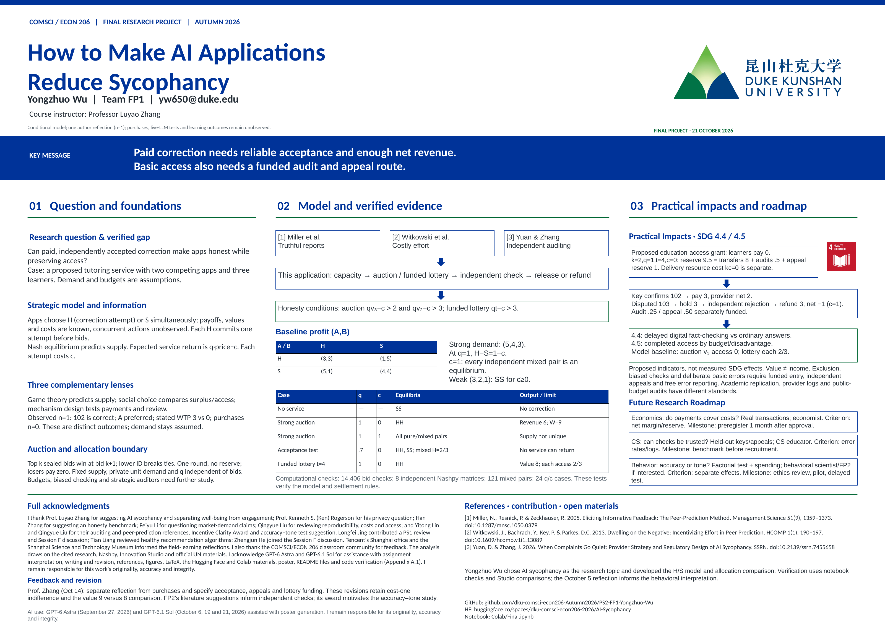

# How to Make AI Applications Reduce Sycophancy

Yongzhuo Wu · Team FP1 · COMSCI/ECON 206 · Professor Luyao Zhang

This project studies when paid corrections make honesty profitable and how an access policy changes that incentive. Two apps choose whether to offer correction capacity. A customer-funded auction and a sponsor-funded lottery expose a trade-off between allocated value, access and funding. Independent acceptance and escrow determine when payment is released.

## Poster

- [Poster PDF](Poster/Final-FP1-Yongzhuo-Wu-A0-Poster.pdf)
- [Editable poster](Poster/Final-FP1-Yongzhuo-Wu-A0-Poster.pptx)

## Demonstration and computation

[Open the demonstration](https://huggingface.co/spaces/dku-comsci-econ206-2026/AI-Sycophancy) · [Run the notebook in Colab](https://colab.research.google.com/github/dku-comsci-econ206-Autumn2026/PS2-FP1-Yongzhuo-Wu/blob/main/Colab/Final.ipynb)

The [notebook](Colab/Final.ipynb) contains the model, proofs checked by computation, settlement examples and funding accounts. Select **Runtime → Run all**. Python 3.12 or later and internet for initial dependency installation are required. Versions are pinned in [requirements.txt](Colab/requirements.txt); no dataset, API key or random seed is needed. See the [notebook instructions](Colab/README.md). Execution details and results are saved in the notebook itself.

The [demonstration source](https://huggingface.co/spaces/dku-comsci-econ206-2026/AI-Sycophancy/blob/main/index.html) runs as a static Hugging Face Space or opens directly in a browser. Change demand, delivery cost and acceptance; compare equilibria; follow acceptance, dispute and refund; and inspect the lottery budget. A [preview](demo-preview.png) shows the default strong-demand example if the Space is unavailable.

| Case | Result |
|---|---|
| Strong auction, q=1, c=0 | HH; price 3, revenue 6, correction surplus 9 |
| Strong auction, q=1, c=1 | Every independent pure or mixed pair is an equilibrium |
| Strong auction, q=.7, c=0 | HH and SS; symmetric mixed p(H)=2/3 |
| Two-slot equal lottery, q=1 | Value 8 versus auction 9; each learner's attempt access 2/3 |
| Funded lottery, t=4, q=1, c=0 | HH; reserve 9.5, no-appeal spend 8.5 |

The October 5 reflection records one author's preference for A and stated willingness to pay of 3 versus 0. Purchases, actual bids, external participants and learning outcomes have n=0. These observations do not estimate market demand. Appendix D explains feedback decisions; Appendix G develops the correction rule, compares the three closest papers and presents the SDG impact and research-roadmap diagrams. Named contributions and acknowledgments appear in the paper and poster.

The [PS2 submission](https://github.com/dku-comsci-econ206-Autumn2026/PS2-FP1-Yongzhuo-Wu/tree/ps2) preserves the earlier paper, code and poster.
